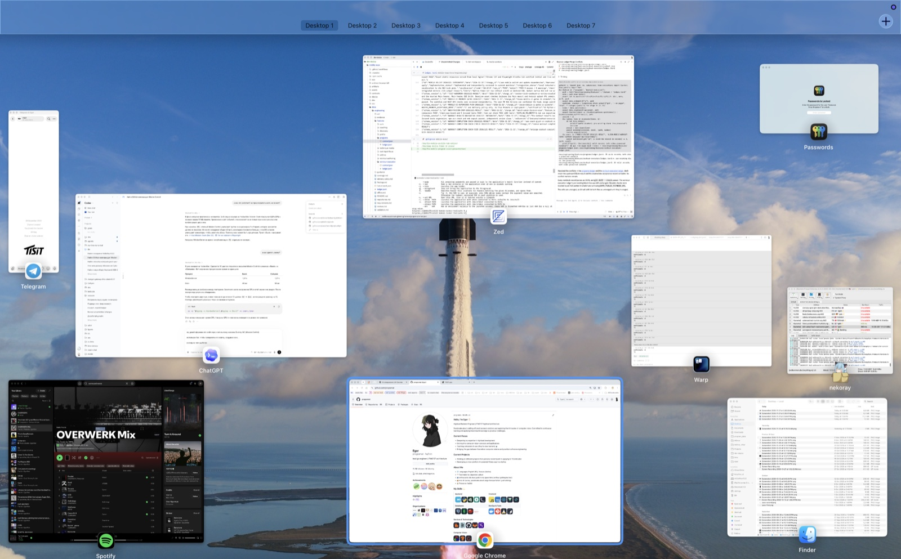
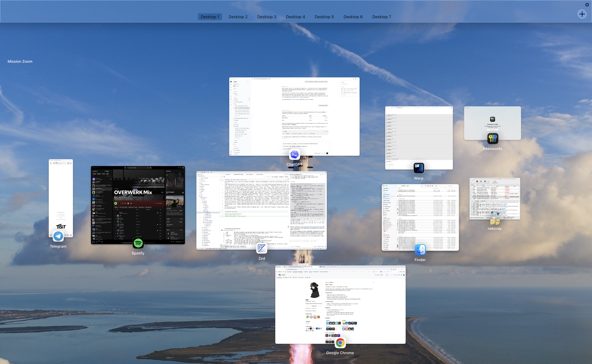
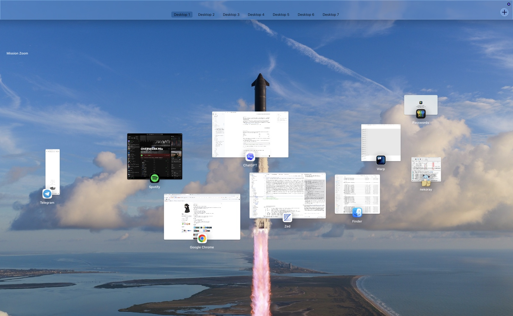

# Dummy MC

[](main.swift)
[](https://github.com/programat/dummy-mc/releases)
[](LICENSE)
[](#quick-start)

Zoom out in macOS Mission Control. Smaller previews leave more room between windows, so you can scan a busy desktop and spot the one you want.

| Off | Moderate | Strong |
| :---: | :---: | :---: |
|  |  |  |


## Quick start

Build from the repository folder with the Xcode Command Line Tools installed.

```sh
./build.sh
open 'dist/Dummy MC.app'
```

Choose **Moderate** or **Strong** from the window icon in the menu bar, then press **Control + ↑**. Choose **Off** to go back to the normal layout.

## The bug

I hit a [Playwright bug](https://github.com/microsoft/playwright/issues/42265) where a headless WebKit window far outside the screen shrank every preview in Mission Control. I turned that bug into a feature by creating a 1 × 1 point AppKit window and putting it thousands of points off-screen. macOS includes it when laying out Mission Control. The bigger area makes the previews smaller.

Tested on macOS 26.3.1 on Apple silicon. The amount of zoom depends on your window layout and display setup.
